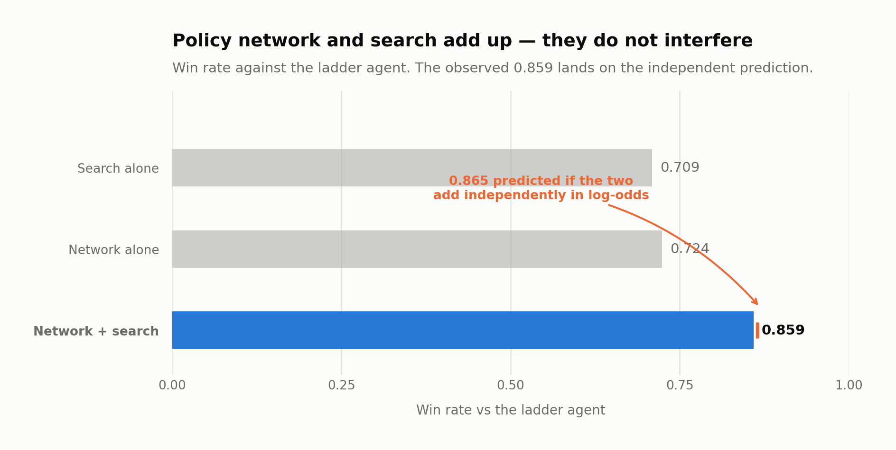

# Pokémon TCG battle agent: imitation learning + search

An agent for Kaggle's **Pokémon TCG AI Battle Challenge** (Simulation track) that combines a
**policy network trained by imitation** on replays from the top of the ladder with a **search
guided by that same network**. The two levers are complementary. Against my previous agent
(n = 2,000 games per row, seats swapped), the network alone wins 0.724, the search alone 0.709
and **both together 0.859**, close to the 0.865 that simple additivity in log-odds predicts.

**Result: 1,328th of 6,807 (top 20%)** on the final leaderboard. Score **773.9** with the
`c1-grimmsnarl` list and 677.1 with `c2-alakazam`: two decks piloted by the same agent.



## What it demonstrates

- **Imitation learning from logged games.** Replays are turned into (state, legal options,
  expert choice) examples: 10,413 episodes and 1.57 M decisions from seven days of games in
  which both players were rated ≥ 1,030. A small policy network, written and trained in pure
  NumPy, learns to score the options. Train/validation/test are split **by episode**, never by
  decision, so the two perspectives of one game cannot leak across splits.
- **Search on top of a learned policy.** The network proposes its best candidates. Only when
  they are close in score does the agent simulate each one (several determinisations of the
  hidden information × a truncated rollout with the network playing both sides) and keep the
  best. Cost: about 32 ms per decision, far inside the per-game time budget.
- **Measurement before decisions.** Every comparison goes through a seat-swapped arena with 95%
  confidence intervals. A hand-written heuristic and plain MCTS were measured and discarded on
  the way.

## Context

The competition, run by The Pokémon Company, has two linked calls: **Simulation**
(`pokemon-tcg-ai-battle`, an agent that plays; no prize money, Knowledge medals) and
**Strategy** (a write-up of ≤ 2,000 words with the prize money). This repository covers the
Simulation half, now closed. The Strategy write-up is not published here.

## Agent architecture

The battle engine (`cabt`) ships inside `kaggle-environments` on PyPI. Two harnesses do all the
measuring: [`arena.py`](arena.py) (two agents, swapped seats, Wilson 95% intervals,
process-level parallelism, because with threads the engine dies with SIGSEGV) and
[`research/gauntlet.py`](research/gauntlet.py) (one agent against the 12 archetypes of the
field).

1. **Policy clone**: [`research/agentes/clon.py`](research/agentes/clon.py), trained with
   [`research/clon/extraer.py`](research/clon/extraer.py) (replays → dataset),
   [`rasgos.py`](research/clon/rasgos.py) (114 state features, 96 per option) and
   [`entrenar3.py`](research/clon/entrenar3.py).
2. **Search on top of the clone**: [`research/agentes/clon_busq.py`](research/agentes/clon_busq.py),
   the final pilot, with the network `politica_7d_h384_mejorval.npz` (not versioned; regenerate
   it by training).
3. **Deck selection**: [`research/decks/`](research/decks), with `c1-grimmsnarl.csv` (chosen for
   the best mean) and `c2-alakazam.csv` (chosen for the floor: never below 0.50 against any of
   the 12 archetypes). These are the two lists actually submitted.

## The candidate that was left out

A stronger candidate existed: `30d+RC` (a 30-day imitation corpus plus a wider search,
`R_PASOS=32, N_CAND=5`) won **74.6% [72.4%, 76.7%]** of its games against the agent on the
ladder. Its evaluation finished on 14 August at 19:35, **15 minutes after** the session that
launched it had ended. A background reminder does not execute anything by itself, and no
scheduled task existed to package and submit it without a human present, so the deadline
passed with the 12 August agent.

**Lesson carried forward:** a deadline commitment with nobody supervising is only real if it
triggers a scheduled task. A reminder informs; it does not execute.

## Limitations

- `RC` (the search setting behind the 74.6%) was only swept on `c2-alakazam`. Whether it
  generalises to `c1-grimmsnarl` was never checked.
- When measuring that candidate, the slowest game reached **595.6 s against a 600 s budget**:
  zero margin, with figures inflated by CPU contention and swap, and without the reduced-budget
  test that would have told the two apart.
- Not everything needed to rebuild the submitted pilot is in this repository. The hand-written
  heuristic used as a legality fallback (`research/agentes/heuristico.py`), the Search API
  wrapper (`research/search_wrapper.py`), the value features (`research/valor/`) and the field
  deck lists used by the gauntlet are missing, so `clon.py`, `clon_busq.py` and `gauntlet.py`
  do not run from a clean clone. `arena.py` does.

## Reproducing

```bash
uv venv .venv --python 3.12
uv pip install --python .venv/bin/python -r requirements.txt
.venv/bin/python arena.py --n 200 --procs 4   # random vs random: checks the engine and the harness
```

`arena.py --a <agent.py> --b <agent.py>` measures any module that exposes `agent(obs)`. The
engine ships in `kaggle-environments` from PyPI, so you do not need to have accepted the
competition rules to use it. The competition's card data
(`kaggle competitions download -c pokemon-tcg-ai-battle-challenge-strategy -p data/raw`) is not
versioned here: the Pokémon licence is revocable, limited to the competition and requires
deleting the data afterwards.

## Working notes

The working log (tickets, decisions with their measurements, the post-mortem of the missed
submission), mostly in Spanish, is in [`docs/internal/`](docs/internal/README.md).
